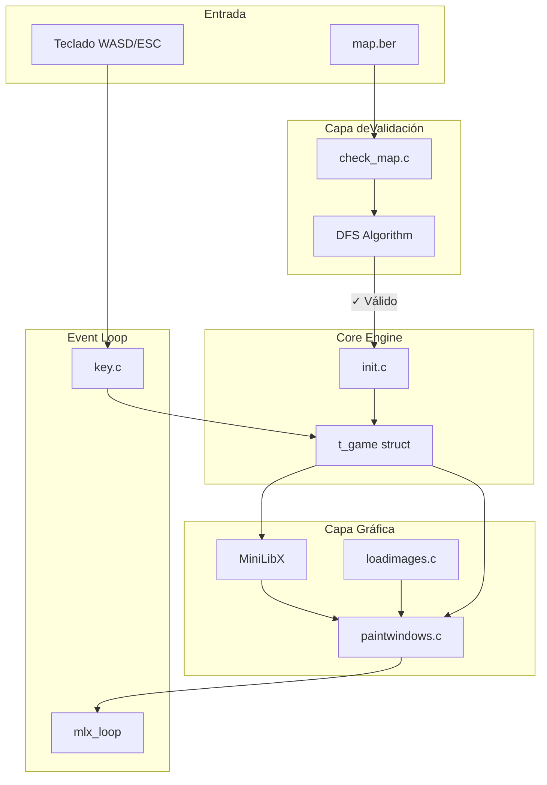

# So_Long


## Descripción

**So_Long** es un juego 2D minimalista desarrollado en C donde el jugador navega por un mapa, recoge coleccionables y alcanza la salida. Implementa validación de mapas robusta mediante algoritmos DFS, gestión de memoria safe y renderizado gráfico con MiniLibX. Proyecto del currículo de42Barcelona que demuestra dominio de low-level programming, estructuras de datos y programación gráfica.

## Características Principales

- **Validación completa de mapas**: Verifica formato rectangular, cierre perimetral, caracteres válidos (P, E, C, 1, 0) y unicidad de jugador/salida
- **Algoritmo DFS para pathfinding**: Comprueba que todos los coleccionables y la salida sean alcanzables desde la posición inicial
- **Control de movimiento fluido**: TeclasWASD para navegación, ESC para salir
- **Contador de movimientos**: Feedback en tiempo real en terminal
- **Gestión de memoria robusta**: Liberación adecuada de todos los recursos (imágenes XPM, mapa, estructuras)
- **Sistema de sprites**: Carga dinámica de texturas XPM para walls, items, player y exit
- **Test suite integrada**: Scripts para validar mapascorrectos eincorrectos

## Stack Tecnológico

| Componente | Tecnología |
|------------|------------|
| Core Language | C (C99) |
| Graphics Library | MiniLibX (X11) |
| Custom Library | libft (libft.a) |
| Build System | Makefile con dependencias automáticas |
| Image Format | XPM |
| Testing | Bash scripts + Valgrind |

## Decisiones Técnicas / Arquitectura

La arquitectura sigue un patrón modular con separación clara de responsabilidades: `check_map.c` centraliza toda la validación del mapa, `reachable.c` implementa el algoritmo DFS para verificar reachability de items y exit, mientras que `key.c` maneja los eventos de input. El uso de MiniLibX sobre X11 directo permite abstraer la complejidad del sistema de ventanas manteniendo control total sobre el render loop. La decisión de implementar DFS bicolor (dos pasadas: una para coleccionables, otra para exit) garantiza que el mapa sea jugable antes de iniciar el juego, evitando estados inválidos en runtime. El patrón de inicialización lazy y cleanup explícito en `x11_utils.c` asegura cero memory leaks.

## Diagrama de Arquitectura



## Guía de Instalación

```bash
# 1. Clonar el repositorio
git clone https://github.com/samuelhm/so_long.git
cd so_long

# 2. Compilar el proyecto (incluye libft y mlx)
make

# 3. Ejecutar con un mapa válido
./so_long maps/map.ber

# 4. (Opcional) Ejecutar tests de validación
./test_valid.sh    # Test mapas correctos
./test_wrong.sh    # Test mapas con errores
./test_leaks.sh    # Test memory leaks con Valgrind
```

**Requisitos**: Linux con X11 development libraries (`libx11-dev`, `libxext-dev`)

## Controles

| Tecla | Acción |
|-------|--------|
| W /↑ | Mover arriba |
| S /↓ | Mover abajo |
| A /← | Mover izquierda |
| D /→ | Mover derecha |
| ESC | Cerrar juego |

## Formato de Mapa

```
111111111111111111
100C1C000000C00001
10111111000000C0E1
1000P0000011100001
10000C000010C00001
1000000000100CC001
1000000000100CC001
110111111110000001
1C0000000000000C01
111111111111111111
```

| Símbolo | Elemento |
|---------|----------|
| `1` | Pared (wall) |
| `0` | Espacio vacío |
| `P` | Jugador (único) |
| `C` | Coleccionable |
| `E` | Salida (única) |

---

## Contacto

[](https://github.com/samuelhm/)
[](https://www.linkedin.com/in/shurtado-m/)